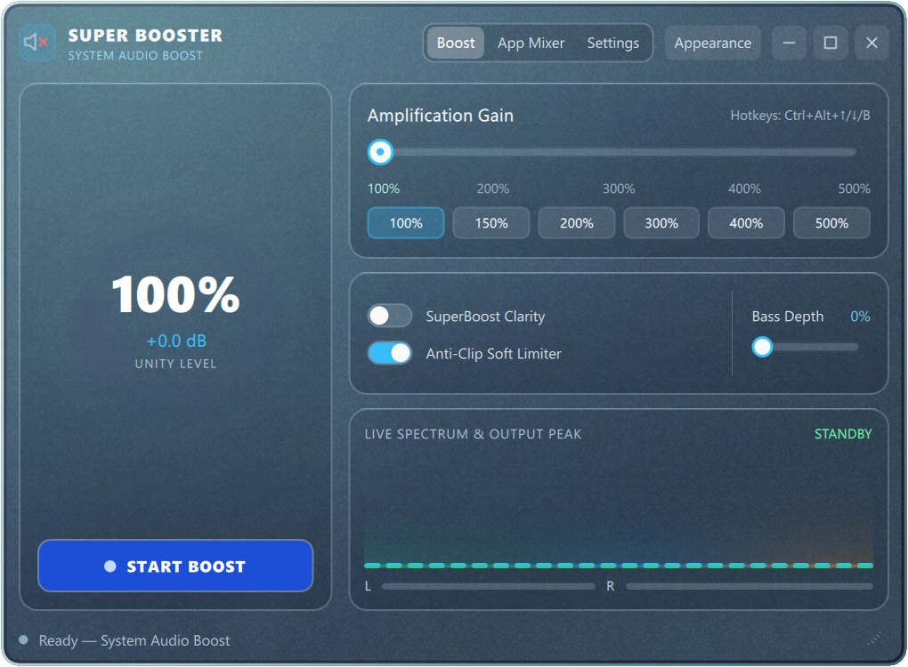

# Super Booster

Super Booster is a Windows desktop audio utility for amplifying and routing audio. It uses Windows Audio Session API (WASAPI) for capture and playback, a Rust audio engine for signal processing, and Qt Quick for the interface.



## Install on Windows

Download the `SuperBooster-*-windows-x64-setup.exe` installer from the [latest release](../../releases/latest) and run it. Setup supports Windows 10 or 11 on x64 and installs for the current account.

Choose from [78 installer language options](packaging/languages/README.md) and select the shortcuts you want in the Start menu or on the desktop. Setup can open **Super Booster** for you to pin. Right-click its taskbar icon and choose **Pin to taskbar**.

### Uninstall

Open **Settings → Apps**, select **Super Booster**, and choose **Uninstall**. The uninstaller keeps saved settings by default. Choose the optional cleanup when prompted if you want to delete the saved settings and remove the remaining installation folder when it is empty.

### Appearance

Open **Menu → Appearance** and choose **Classic Acrylic** for the original compact layout with an Acrylic finish. Use the **Appearance** button in that layout to switch back to **Glass Panels**. Super Booster remembers your layout across restarts and saves your Glass Panels material separately.

Fresh installs start with **Glass Panels** in **Frosted**. Glass Panels also offers **Clear**, **Acrylic**, **Mica**, **Blurred**, and **Glassy**. The desktop stays visible through the seams, and each finish is clipped to the glass panels. **Blurred** samples the Windows wallpaper when available and uses a translucent finish otherwise.

### App updates

To download and install updates in the background, open **Appearance** and turn on **Automatically install updates**. It’s off by default. Super Booster waits for its window to be hidden or minimized and for audio to be idle before installing. The verified update installs without an installer window or an update pop-up.

Open **Update settings** from **Appearance** to check manually, open GitHub Releases, turn off background checks, or choose how update notifications appear. When an update alert appears, use **Later** to defer it for an hour or the close button to dismiss that version. Choose **Update** to read the release notes and apply the verified installer.

Super Booster listens for release alerts while it is open, including in the system tray, and checks for missed releases at startup. Updates preserve the installed folder, existing shortcuts, and settings.

## Audio modes

- **System Audio Boost** captures audio sent to one playback device and plays it through a separate set of headphones or speakers. If **Automatic Digital Output** is available, it can use an enabled, unused digital output as the source. For manual setup, select a separate silent playback source and route the apps you want to boost to it in Windows Volume Mixer.
- **Device Routing** processes audio from a selected recording input and plays it on a selected output.

Both modes offer gain up to 500%, a soft limiter, and live signal meters and spectrum. The tray menu gives quick access to the gain slider. Settings include optional Windows startup and global hotkeys for raising gain, lowering gain, and toggling boost.

## Build from source

The [Windows installer workflow](../../actions/workflows/windows.yml) compiles the app, runs the audio and layout tests, and verifies the installer on a GitHub-hosted Windows runner. Download the installer artifact from any successful run.

Use PowerShell on 64-bit Windows with Qt 6.8.3 for MinGW (including Qt Shader Tools and Qt WebSockets), MinGW 13.1, Ninja, CMake 3.21 or newer, and Rust. Adjust the Qt paths if it is installed elsewhere.

```powershell
rustup target add x86_64-pc-windows-gnu
$qt = 'C:/Qt/6.8.3/mingw_64'
$mingw = 'C:/Qt/Tools/mingw1310_64/bin'
$ninja = 'C:/Qt/Tools/Ninja/ninja.exe'
$cmake = 'C:/Qt/Tools/CMake_64/bin/cmake.exe'
$env:Path = "$mingw;$qt/bin;$env:Path"

& $cmake -S . -B build -G Ninja `
  -DCMAKE_BUILD_TYPE=Release `
  "-DCMAKE_PREFIX_PATH=$qt" `
  "-DCMAKE_CXX_COMPILER=$mingw/g++.exe" `
  "-DCMAKE_MAKE_PROGRAM=$ninja"
& $cmake --build build
cargo test --locked --target x86_64-pc-windows-gnu --manifest-path audio_core/Cargo.toml
```

### Package the installer

From the same PowerShell session, deploy the build into a fresh `dist/app` directory. Use Inno Setup 7.1.1 to compile the installer.

```powershell
New-Item -ItemType Directory -Path dist/app
Copy-Item build/super_booster.exe dist/app/
Copy-Item build/super_booster_update_helper.exe dist/app/
& "$qt/bin/windeployqt.exe" --release --no-patchqt --no-translations `
  --no-system-d3d-compiler --no-system-dxc-compiler --no-opengl-sw `
  --skip-plugin-types qmltooling,generic --qmldir qml dist/app/super_booster.exe
@('[Paths]', 'Prefix=.', 'Plugins=.', 'QmlImports=qml') |
  Set-Content dist/app/qt.conf -Encoding ascii
Copy-Item third-party dist/app/ -Recurse
./packaging/Build-Installer.ps1 -StageDirectory dist/app -OutputDirectory dist `
  -Version 2.1.3 -IsccPath 'C:/path/to/ISCC.exe'
```

Qt, MinGW, and Rust dependency notices are in [third-party](third-party/README.md), along with corresponding Qt source links.

The [release notification service](release-push/README.md) documents the GitHub webhook, Cloudflare deployment, and WebSocket message format. Set `SUPER_BOOSTER_PUSH_URL` when configuring CMake if the service hostname changes.

For each stable release, use the `v<version>` tag and attach both the Windows setup executable and `super-booster-update.json` from the successful Actions artifact before publishing. The manifest lets the app verify the installer even when GitHub’s public API is rate-limited. A `body` field containing the release notes is optional.
